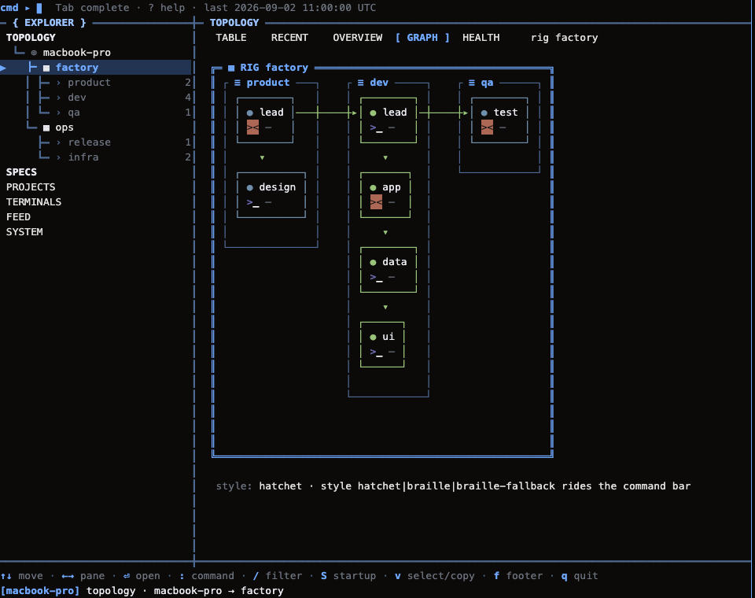
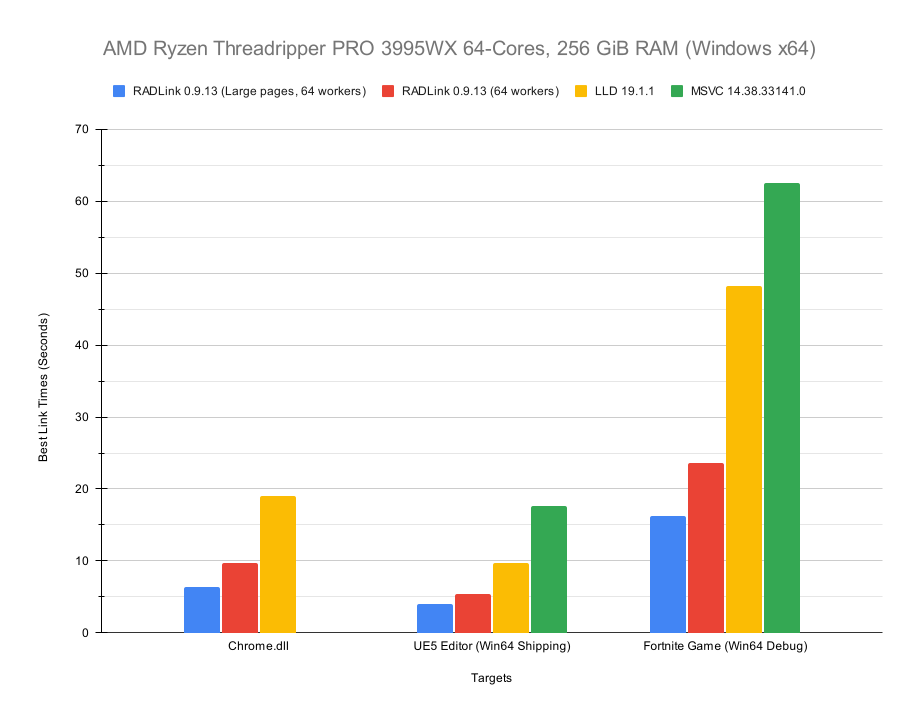
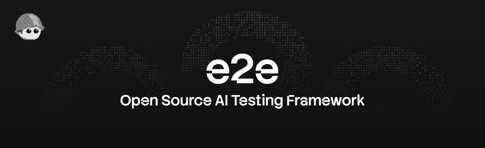
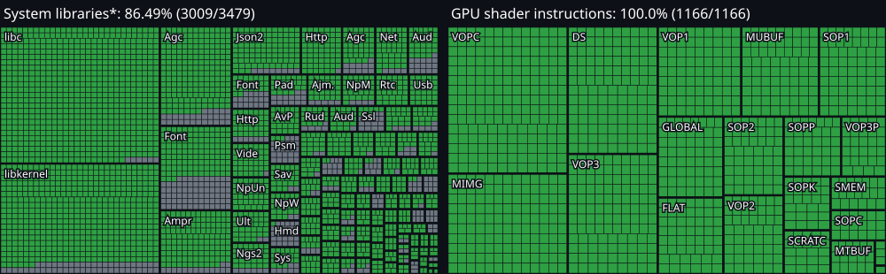

# GitHub 一周热点 · 第 17 期

> 📅 2026-10-12 ｜ 数据来源：GitHub Trending（本周）

> 本期周刊共收录 12 个项目。AI 领域以编程智能体的技能集合、上下文压缩与多智能体编排为主，claude-mem 提供跨会话的持久化记忆；开发工具方面涉及 Cursor 插件市场、原生调试器与端到端测试框架；Web 与客户端方向包含 AI 友好的视频渲染引擎与跨端 UI 框架。

## AI / 大模型应用

### [mattpocock/skills](https://github.com/mattpocock/skills)

- ⭐ 累计 Star：286,374
- 🔥 本周新增 Star：10,330
- 💻 Shell
- 🔗 官网：https://aihero.dev/skills

TypeScript 教育者 Matt Pocock 开源的日常 AI 编程智能体技能集合，把软件工程基本功提炼为小而可组合的技能，而非 GSD、BMAD、Spec-Kit 那类接管流程的大框架。围绕四大常见失败模式设计：用 /grill-me、/grill-with-docs 等拷问式提问对齐需求、建立 GLOSSARY.md 共享语言；用 /tdd、/diagnosing-bugs 建立红绿重构与调试反馈闭环；用 /to-spec、/to-tickets、/implement、/wayfinder、/improve-codebase-architecture 覆盖规格化、任务拆分、并行实现与架构梳理。技能按用户调用与模型自动调用两轴划分，支持 Claude Code、Codex、GitHub Copilot、Gemini CLI 及 Cursor、Windsurf 等各类智能体，安装后运行 /setup-matt-pocock-skills 每仓库配置一次即可使用。

**简单说：** 这是一套可直接装进 Claude Code、Copilot 等 AI 编程工具里的“工程方法说明书”：让 AI 先反问你把需求问清楚、用测试驱动写代码、按规格拆任务再实现，从而减少 AI 生成代码跑偏、啰嗦、难维护的问题，适合日常用 AI 写真实项目的开发者。

`#ai-agents` `#coding-skills` `#claude-code` `#tdd` `#software-engineering` `#developer-tools`

### [ranxianglei/billion-context](https://github.com/ranxianglei/billion-context)

- ⭐ 累计 Star：925
- 🔥 本周新增 Star：337
- 💻 TypeScript

billion-context 是一个上下文压缩代理，插在任意 AI 编码代理与模型 API 之间，通过改写 Anthropic/OpenAI 请求流实现基于 acp-kernel 的增量压缩，让 100K 小上下文窗口的模型也能跑出数十亿 token 的超长会话。代理会注入 compress、decompress、search_context、acp_status 四个上下文管理工具，由模型自行决定何时压缩、压缩什么，压缩是增量、可逆且对前缀缓存友好的，并可用 /acp-cache 打印缓存命中率报告（健康会话约 95–97%）。项目自带 pi、opencode、omp、dsh、kimi、claude、codex、gemini-cli 等二十余种客户端的接入方式（原生插件 / 启动器 / 证书 MITM / /bili/ URL 前缀），并开源了一篇 4.5 个月、17 万次调用、约 188 亿 token 的纵向研究论文。

**简单说：** 它解决的是长编码会话上下文爆掉、token 费用飙升的问题：把已经聊过的内容压缩成摘要，需要时再还原，让便宜的小窗口模型也能撑住几周不间断的开发会话。无论你用 Claude Code、Codex 还是 aider，都能以插件、启动器或改 baseURL 三种方式之一接入。

`#context-compression` `#proxy` `#coding-agents` `#llm` `#token-savings` `#dsh-plugin`

### [mvschwarz/openrig](https://github.com/mvschwarz/openrig)

- ⭐ 累计 Star：6,998
- 🔥 本周新增 Star：2,028
- 💻 TypeScript
- 🔗 官网：https://openrig.dev

OpenRig 是一个开源的多智能体编排工具，用 YAML RigSpec 定义 AI 编码团队，一条命令（rig up）即可把 Claude Code、Codex 等终端编码智能体组织成有角色、有共享上下文、有任务归属的持久化团队，用户与 lead agent 沟通产出，由它协调各领域 agent 并回报需要人工决策的事项。通过 tmux 管理会话，提供 TUI 拓扑视图与 operator 对话界面，支持跨 agent 通信（rig send/broadcast/chatroom）、快照恢复与 rig bundle 分发，内置 starter、workshop、factory 等预设团队模板，核心概念包括 Seat、Pod、Discovery/Adopt 与 Culture。托管启动会为各 agent 注入环境变量与沙箱参数，席位默认受限权限、YOLO 全跳过模式默认关闭；0.6.0 起仅支持 Node.js 22/24，跨 0.5.9 布局边界需走迁移流程，适用于 macOS、Linux（Windows 需 WSL2）。

**简单说：** 它就像给多个 AI 编码助手雇了个项目经理：把散落在各个终端里的 Claude Code、Codex 会话组织成有工位、有分工、有记忆的团队，统一启动、通信、恢复和管理权限。想让多个 AI 像小团队一样长期协作开发项目的开发者会用到它。

`#agent-orchestration` `#multi-agent` `#agent-harness` `#ai-coding` `#claude-code` `#codex-cli`

### [earthtojake/text-to-cad](https://github.com/earthtojake/text-to-cad)

- ⭐ 累计 Star：19,308
- 🔥 本周新增 Star：2,508
- 💻 Python
- 🔗 官网：https://www.texttocad.dev

text-to-cad 是一个给 AI 编程/智能体插件用的 CAD 技能库，让 Claude Code、Codex、Cursor、Gemini、Grok 等 agent 在本地生成 STEP、STL、3MF、GLB 格式的 3D 模型。除建模外，还提供工程图纸生成、DXF 二维图、机器人描述文件（URDF/SRDF/SDF）、可制造性检查（DFM/DfAM）、G-code 切片以及对接 SendCutSend、Bambu 打印机等制造服务的一系列 skills，底层基于 build123d 与 Open CASCADE 内核，通过 uv 运行的 cadgen 提供本地 MCP 服务器和浏览器查看器。

**简单说：** 它相当于给 AI 助手装上“机械设计工具箱”：用自然语言让 agent 画零件、出图纸、查能否加工或打印，最后还能直接送到打印或加工服务。适合想用 AI 辅助做机械设计、机器人仿真或 3D 打印的开发者和工程师。

`#ai-agents` `#cad` `#mechanical-engineering` `#robotics` `#mcp` `#3d-printing`

### [thedotmack/claude-mem](https://github.com/thedotmack/claude-mem)

- ⭐ 累计 Star：99,770
- 🔥 本周新增 Star：3,803
- 💻 TypeScript
- 🔗 官网：https://claude-mem.ai

claude-mem 为各类 AI 编码代理提供跨会话的持久化上下文：自动记录 agent 在会话中做过的所有事，用 AI 压缩后在后续会话中把相关上下文重新注入，兼容 Claude Code、OpenClaw、Codex、Gemini、Hermes、Copilot、OpenCode 等多种客户端。项目基于 Claude Agent SDK、用 TypeScript 编写；仓库还提供文档、Issues、官方 X 账号与 Discord 等支持渠道，并提到一个第三方创建、获作者认可的同名 CMEM 代币（属社区层面，与工具功能无关）。

**简单说：** 它解决的是 AI 编程助手“每次开新会话都失忆”的问题：把 agent 干过的事自动记下来、压缩存好，下次开会话再挑相关的塞回去，让 Claude Code 等工具记住你之前的项目进展。

`#ai-memory` `#ai-agents` `#context` `#typescript` `#claude-code`

### [danyuchn/asd-ste100-skill](https://github.com/danyuchn/asd-ste100-skill)

- ⭐ 累计 Star：4,509
- 🔥 本周新增 Star：936
- 💻 Python

该项目把 ASD-STE100 简化技术英语（Simplified Technical English）规范改造成一个 Claude Code 技能，用于把含糊、冗长的英文改写为规则化、无歧义的表达，原先是航空领域的技术文档写作标准。应用到智能体场景后，它主要帮助开发者写出更清晰、更不容易被 agent 误读的指令与文档。

**简单说：** 它把一套航空业的“说人话”英文写作规范做成了 Claude Code 技能：帮你把含糊啰嗦的英文指令改写成清晰无歧义的版本，减少 AI 读错需求的情况。

`#claude-code` `#skill` `#technical-writing` `#simplified-english` `#ai-agents`

## 开发工具与平台

### [cursor/plugins](https://github.com/cursor/plugins)

- ⭐ 累计 Star：10,915
- 🔥 本周新增 Star：1,140
- 💻 TypeScript

Cursor 官方插件仓库，同时承载 Cursor 插件规范的定义。仓库采用多插件市场结构：根目录的 .cursor-plugin/marketplace.json 汇总所有插件，每个插件是独立目录，包含自己的 plugin.json 清单、skills（SKILL.md）、rules（.mdc）和 mcp.json 等。插件涵盖开发工作流（如 PR 审查画布、并行编排、分支深度审计、CLI 设计规范）、SaaS 集成（GitHub、Google 全家桶、Salesforce、Shopify、各家 CRM 与营销工具）以及金融与数据服务。

**简单说：** 这是 Cursor 编辑器的官方插件市场和规范仓库，开发者可以像逛应用商店一样挑选插件，让 Cursor 直接操作 GitHub、Google、Salesforce 等外部服务，或获得更规范的代码审查、并行任务等工作流能力。

`#cursor` `#plugins` `#mcp` `#ai-agents` `#developer-tools` `#integrations`

### [EpicGames/raddebugger](https://github.com/EpicGames/raddebugger)

- ⭐ 累计 Star：8,400
- 🔥 本周新增 Star：794
- 💻 C

RAD Debugger 是 Epic Games 开源的原生、用户态、多进程图形化调试器，目前处于 ALPHA 阶段，支持本机 Windows x64 与 PDB 调试，并计划扩展到 Linux 与 DWARF；配套还有自研的 RAD Debug Info（RDI）调试信息格式，以及面向超大可执行文件优化、兼容 MSVC 命令行语法、链接速度提升约 50% 的 RAD Linker（支持大页内存）。源码按“层”组织在 src 目录下，每层对应 1-3 个字符的 C 风格命名空间前缀，层间只允许单向依赖形成有向无环图，部分 lib_ 前缀层（如 lib_rdi、lib_rdi_make）完全独立可作库移植。各层职责清晰：ctrl 与 demon 负责多进程控制与断点，dbg_engine 是无图形界面的调试核心，eval 是求值变量/寄存器/类型的表达式编译器，pdb/elf/pe/codeview/dwarf 等层解析二进制与调试信息，rdi_from_* 层将 PDB、COFF、ELF 等转为 RDI，另有渲染、UI、字体缓存、异步文件与数据缓存等基础设施层，最终由 raddbg 层组装成图形化调试器前端。

**简单说：** 这是 Epic Games 自研的 C 语言调试器及配套链接器，目标是把超大项目的编译调试循环做得又快又稳，适合需要调试大型 Windows x64 程序的系统/游戏开发者。仓库里的分层说明还能帮你快速定位想复用的功能（如 DWARF 转 RDI、表达式求值）在哪个目录。

`#debugger` `#linker` `#windows` `#cpp` `#tools` `#architecture`

### [tester-army/e2e](https://github.com/tester-army/e2e)

- ⭐ 累计 Star：9,099
- 🔥 本周新增 Star：6,440
- 💻 TypeScript
- 🔗 官网：https://tester.army/e2e

下一代端到端测试框架，面向 Web 与移动端应用的 e2e 测试，基于 Playwright 生态构建，主打现代化的测试编写与执行体验。

**简单说：** 这是一个用来给网页和手机 App 做端到端自动化测试的框架，可以模拟真实用户操作来验证整个应用是否正常工作。

`#e2e-testing` `#end-to-end-testing` `#mobile-testing` `#playwright` `#testing-framework`

### [boykopovar/AnyPS5](https://github.com/boykopovar/AnyPS5)

- ⭐ 累计 Star：30,364
- 🔥 本周新增 Star：25,151
- 💻 C++
- 🔗 官网：https://discord.gg/BHFztBPUe

AnyPS5 是一个用 C++ 编写的工具，用于把 PS5 游戏可执行文件自动移植（port）到 Linux 和 Windows 平台，涉及动态库与 SPIR-V 着色器等底层适配工作。

**简单说：** 它是一个把 PS5 游戏程序自动搬到 Linux 和 Windows 上运行的移植工具，面向喜欢折腾主机游戏跨平台运行的开发者。

`#ps5` `#game-porting` `#dynamic-library` `#spir-v` `#cpp`

## Web / 客户端应用

### [heygen-com/hyperframes](https://github.com/heygen-com/hyperframes)

- ⭐ 累计 Star：61,043
- 🔥 本周新增 Star：4,223
- 💻 TypeScript
- 🔗 官网：https://hyperframes.dev

HyperFrames 是一个 AI 友好的视频引擎：用带 data 属性的普通 HTML 定义时间轴和轨道，支持 GSAP、CSS、Lottie、Three.js 等可 seek 的动画适配器，在无头 Chrome 中逐帧渲染后用 FFmpeg 编码，同输入必然产出同视频。项目包含 CLI、核心引擎、组件 Catalog、Agent skills、Studio 编辑器、设计模板库与 AWS Lambda 分布式渲染等一整套工具，采用 Apache 2.0 协议；作者将其与 Remotion 的 React 方案对比，主打无构建步骤的纯 HTML。

**简单说：** 它让开发者（尤其是 AI 编码 Agent）直接用普通 HTML 写动画脚本就能稳定渲染成视频，省去 React 工程和时间轴软件，适合短视频、动态图表、社媒素材的自动化批量生产。

`#html` `#video` `#animation` `#ffmpeg` `#gsap` `#ai`

### [flutter/flutter](https://github.com/flutter/flutter)

- ⭐ 累计 Star：179,814
- 🔥 本周新增 Star：680
- 💻 Dart
- 🔗 官网：https://flutter.dev

Flutter 是 Google 推出的开源 UI 框架，用一套 Dart 代码库即可同时构建移动端、Web 与桌面端（Windows、macOS、Linux）应用。它基于 Skia 与 Impeller 等硬件加速 2D 图形库自行渲染界面，可编译为 ARM 机器码、JavaScript、WebAssembly 等多种产物，主打无卡顿的原生级性能。开发体验上提供有状态热重载，修改代码后无需重启即可看到效果；生态内置 Cupertino 与 Material 两套像素级精细的组件库，并支持通过 FFI 和 platform channels 调用各平台原生代码，兼容 VS Code、IntelliJ / Android Studio 等工具。

**简单说：** 它解决的问题是：一套代码写完，手机、网页、桌面应用都能跑，不用为每个平台单独开发。想做跨平台 App 的个人开发者和公司团队基本都会考虑它，尤其适合既要界面好看、又要性能流畅的场景。

`#flutter` `#cross-platform` `#dart` `#mobile` `#ios` `#android`
