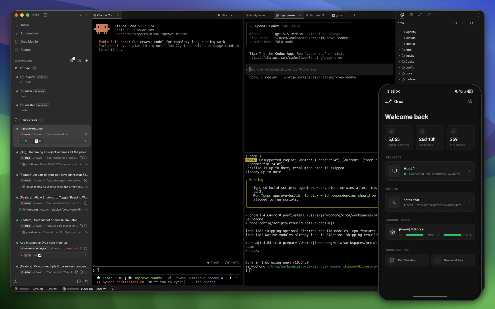
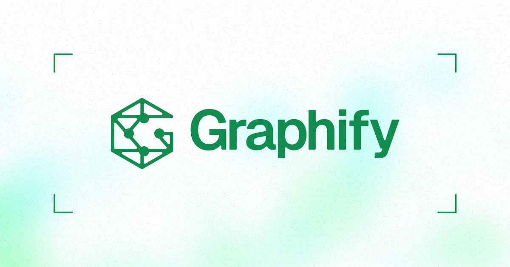
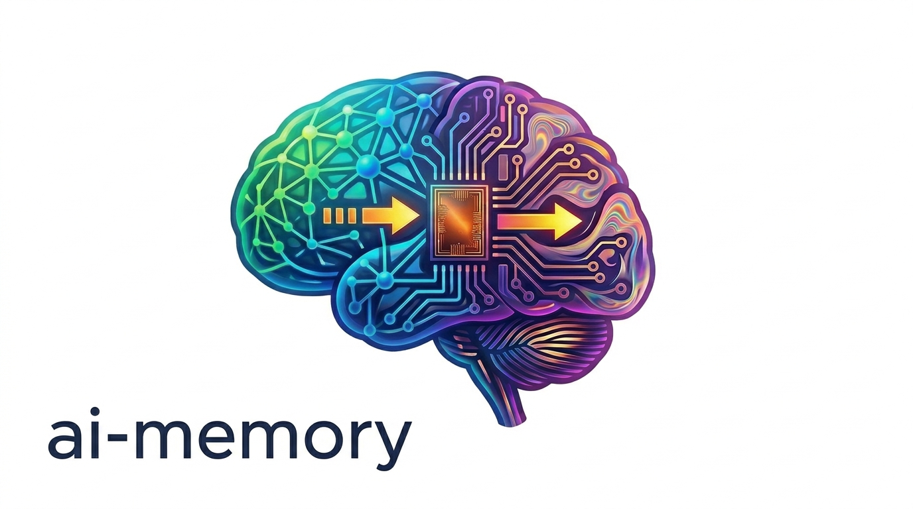
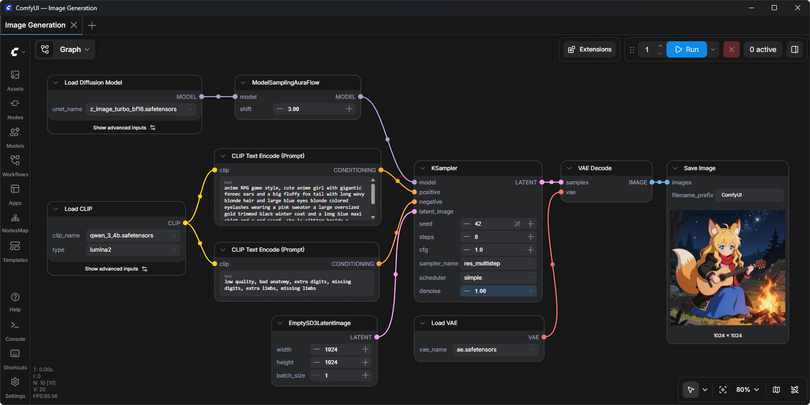

# GitHub 一周热点 · 第 19 期

> 📅 2026-10-26 ｜ 数据来源：GitHub Trending（本周）

> 本期周刊共收录 14 个项目。收录项目集中于 AI 编码智能体生态：涵盖多智能体编排与远程操控（如 ruflo、Orca）、跨工具长期记忆与代码知识图谱，以及模型推理服务与插件分发等方向。

## 其他项目

### [cloudflare/security-audit-skill](https://github.com/cloudflare/security-audit-skill)

- ⭐ 累计 Star：47,060
- 🔥 本周新增 Star：15,072
- 💻 JavaScript

### [ruvnet/ruflo](https://github.com/ruvnet/ruflo)

- ⭐ 累计 Star：79,306
- 🔥 本周新增 Star：2,987
- 💻 TypeScript
- 🔗 官网：https://Cognitum.One

Ruflo 是一个面向 Claude Code 和 Codex 的智能体「元外壳」（meta-harness），为模型提供工具、记忆、循环、沙箱与管控，让 100+ 个专用 agent 能自组织成 swarm 协同工作，并支持跨机器联邦通信与企业级安全护栏。它提供两种安装路径：Claude Code 插件（轻量，仅斜杠命令与 agent 定义）和 CLI 完整安装（98 个 agent、60+ 命令、30 个技能、MCP server、hooks 与守护进程），另有可独立运行的终端 UI 与可视化控制台，可追踪工作流、成本与 agent 日志。核心能力包括自学习记忆、向量 RAG 检索、图推理、联邦协作和测试/文档生成等 35 个插件，适合想让 AI 编码助手从单次问答升级为可复用多 agent 团队的开发者。
这部分 README 展示了 ruflo 的插件生态与核心能力：插件按安全审计、架构方法论（ADR、DDD、SPARC）、DevOps 可观测性、IoT 与量化交易等领域分类，共含 33 个 Claude Code 原生插件和 21 个 npm 插件。核心能力包括 100+ 专业智能体、零信任联邦协作（mTLS + ed25519 身份验证、PII 自动过滤、行为信任评分、合规审计轨迹）、HNSW 向量记忆与 SONA 自学习、5 家 LLM 提供商的智能路由，以及 MetaHarness 用于对智能体配置做安全评估与打分。安装上支持一行脚本或 npx 交互式向导（Windows 可用），并可作为 MCP Server 接入 Claude Code。

**简单说：** 它给 Claude Code / Codex 这类 AI 编码工具加一层「指挥系统」：把大任务拆给多个 agent 分工执行、记住历史经验、跨机器协作，你只管写代码。适合想把 AI 助手从单次对话变成会自动分工、自我改进的团队的开发者。
它相当于给 Claude Code 这类 AI 编程工具加装的一整套「插件市场 + 多智能体协作层」：让多个 AI 智能体像团队一样分工、共享记忆、跨机器安全协作，同时提供安全扫描和成本监控等配套工具，适合想把 AI 编程助手升级为自动化开发团队的开发者。

`#agentic-ai` `#multi-agent` `#swarm-intelligence` `#claude` `#codex` `#harness`

### [anthropics/knowledge-work-plugins](https://github.com/anthropics/knowledge-work-plugins)

- ⭐ 累计 Star：33,008
- 🔥 本周新增 Star：2,790
- 💻 Python

这是 Anthropic 开源的知识工作者插件仓库，主要面向 Claude Cowork，也兼容 Claude Code。仓库收录了 11 个插件，按职能划分（如生产力、销售、客服、产品、市场、法务、财务、数据、企业搜索、生物科研等），每个插件打包了该岗位所需的 skills、斜杠命令、子代理和 MCP 连接器。全部组件都是 markdown 和 JSON 文件，无代码无构建步骤，用户可替换连接器、注入公司术语与流程，或用 cowork-plugin-management 插件自建新插件。

**简单说：** 相当于给 Claude 预装的「岗位工作手册 + 工具接线」套装，装上后 Claude 就按你团队的流程和术语干活，适合想让 AI 深度融入现有工作流的团队直接使用或二次定制。

`#claude` `#cowork` `#plugins` `#knowledge-work` `#mcp` `#claude-code`

### [anomalyco/opencode](https://github.com/anomalyco/opencode)

- ⭐ 累计 Star：221,558
- 🔥 本周新增 Star：5,921
- 💻 TypeScript
- 🔗 官网：https://opencode.ai

OpenCode 是一个开源 AI 编程助手（coding agent），提供终端 UI，另有 Beta 版桌面应用，支持 npm、Homebrew、pacman、Nix 等多种安装方式。内置两个可切换的 agent：build 为默认的全权限开发 agent，plan 为只读的分析与代码探索 agent（默认禁止改文件、执行命令前需确认），另有一个可用 @general 调用的通用子 agent 处理复杂搜索和多步任务。README 提供十余种语言版本，配置细节见官方文档。

**简单说：** 一个开源版的 AI 编程终端工具，类似在命令行里帮你读代码、改代码、跑命令的助手，适合想自己掌控工具链和数据的开发者使用。

`#coding-agent` `#ai` `#terminal` `#open-source` `#cli`

### [stablyai/orca](https://github.com/stablyai/orca)

- ⭐ 累计 Star：105,929
- 🔥 本周新增 Star：9,622
- 💻 TypeScript
- 🔗 官网：https://orca.dev

Orca 是一款面向「100x builders」的 AI 编程代理编排 IDE，定位是把 Codex、Claude Code、OpenCode、Pi 等多种 CLI 编码代理并排运行在各自的隔离 git worktree 中，统一集中管理与对比结果。核心能力包括：把同一个提示词扇出给多个代理并行执行再合并胜者、手机端伴侣应用远程监控与追加指令、WebGL 渲染的终端分屏、Design Mode 点击真实 Chromium 页面元素将 HTML/CSS 与截图直接注入提示词、GitHub/Linear 原生集成、SSH 远程 worktree、AI diff 行级批注、可脚本化的 Orca CLI 等。它支持 macOS、Windows、Linux 桌面端以及 iOS/Android 移动端，只要能在终端运行的 CLI 代理都可接入。项目采用 MIT 协议开源，由 YC 支持。

**简单说：** 它本质上是一个「多个 AI 编程助手的指挥台」：把不同厂商的编码代理各自放进独立的 git worktree 里同时干活，你在一个界面里比较谁做得好、合并最好的那版，还能在手机上盯着它们跑。适合同时使用多家 AI 编码工具、想把代理任务批量并行化的开发者。

`#agent-ide` `#ai-agents` `#orchestration` `#terminal` `#worktrees` `#claude-code`

### [heygen-com/hyperframes](https://github.com/heygen-com/hyperframes)

- ⭐ 累计 Star：72,222
- 🔥 本周新增 Star：5,612
- 💻 TypeScript
- 🔗 官网：https://hyperframes.dev

HyperFrames 是一套面向 AI agent 的「写 HTML、渲视频」框架，用纯 HTML + CSS + 可寻址（seekable）动画直接产出视频，无需构建步骤，index.html 即可播放，非常适合 agent 直接交接纯 HTML 文件。它通过 Puppeteer + FFmpeg 实现逐帧精确的页面转视频捕获，并提供 CLI、core、engine、producer、studio、player、shader 过渡和 AWS Lambda 分布式渲染等一整套 npm 包，本地与云端渲染路径齐备。项目在 HeyGen 生产环境使用，被 tldraw、TanStack 等团队采用，采用 Apache 2.0 许可，与 Remotion 相比差异主要在授权与创作方式上。仓库开发时依赖 Git LFS 存放约 240 MB 的回归测试基线视频，只取源码可用 GIT_LFS_SKIP_SMUDGE=1 跳过。

**简单说：** 它解决的是「用代码批量、可复现地生成视频」的问题：不用视频编辑软件，直接写网页，再由引擎逐帧截图合成 mp4，适合需要自动化出片的开发者和 AI agent。相当于把浏览器当成视频渲染器。

`#ai` `#ai-agents` `#animation` `#claude-code` `#ffmpeg` `#framework`

### [android/skills](https://github.com/android/skills)

- ⭐ 累计 Star：9,731
- 🔥 本周新增 Star：1,070
- 💻 Kotlin

Android skills 是 Google 官方维护的 Android 开发 AI agent 技能仓库，包含一组面向 LLM 优化的模块化 Markdown 指令（SKILL.md），遵循 open-standard agent skills 标准，帮助 AI 更准确地执行符合 developer.android.com 最佳实践的开发任务。其开发重点放在评测中 LLM 表现较弱的场景，而非 Compose 基础用法这类模型已擅长的领域。可通过 Android CLI 安装单个或全部技能到项目或 agent 目录（默认安装到 ~/.gemini/antigravity/skills），也支持作为插件安装到 Claude Code 和 Codex，技能会在任务相关时被 agent 自动激活。项目目前不接受公开贡献，采用 Apache 2.0 许可。

**简单说：** 它相当于给 AI 编程助手（如 Gemini、Claude Code）补发的「Android 官方操作手册」，让 agent 在做 Android 开发任务时少犯错、按 Google 的规范办事，开发者安装后无需额外提示即可生效。

`#android` `#ai-agents` `#skills` `#llm` `#kotlin`

### [Graphify-Labs/graphify](https://github.com/Graphify-Labs/graphify)

- ⭐ 累计 Star：135,334
- 🔥 本周新增 Star：6,903
- 💻 Python
- 🔗 官网：https://www.graphify.com

Graphify 是一个 CLI 工具加 AI 助手技能（skill），可将整个项目——代码、文档、SQL schema、配置文件、PDF、图片、视频——映射为一张可查询的知识图谱，替代在文件里 grep 搜索。代码部分用 tree-sitter AST 在本地做确定性解析，不依赖 LLM、数据不出本机；每条边都标注 EXTRACTED（源码明确写出）或 INFERRED（推理解析得出）。产物为 graph.html（浏览器交互浏览）、GRAPH_REPORT.md（要点摘要）和 graph.json（持久化图谱），支持 query、path、explain 三种查询方式，并内置 God 节点、Leiden 社区检测、跨文件调用/导入/继承关系解析（约 40 种语言）。支持 Claude Code、Cursor、Codex、Gemini CLI 等 20+ 助手，安装后在助手中输入 /graphify 即可使用；另提供 Graphify Cloud 付费版覆盖 monorepo、跨仓库和形式化验证等场景。
本部分介绍了 graphify 的可选扩展（PDF、Office、视频转写、MCP 服务器、Neo4j/FalkorDB 推送、Leiden 社区检测、多语言 AST 提取、中分词及多种 LLM 后端等约 25 种 extra），以及通过 graphify install 在 Claude Code、Codex、Cursor 等平台上写入 hook 或指令文件、让助手优先查询知识图谱的集成方式。此外还覆盖了 GRAPH_REPORT.md 报告内容、约 40 种语言的 tree-sitter 本地解析、query/path/explain 等常用命令、.graphifyrc 项目配置（含歧义扩展名声明）、团队共享图谱与 PR 审查工作流，以及隐私策略（代码本地处理、无遥测、查询日志可关闭）。

**简单说：** 它把你的代码仓库变成一张能点、能问、能追溯的“地图”，AI 助手或你自己查架构时不用再全仓库翻文件、烧 token。适合维护大型或陌生代码库、想让 AI 编码助手更懂项目上下文的开发者。
它相当于给整个代码库建一个可查询的"大脑"：装好之后 AI 助手回答代码问题时会先查这张图谱，而不是漫无目的地翻文件，适合想让 Claude Code、Cursor 等助手真正读懂自己项目的开发者。

`#ai-agents` `#ast` `#claude-code` `#code-analysis` `#knowledge-graph` `#graphrag`

### [akitaonrails/ai-memory](https://github.com/akitaonrails/ai-memory)

- ⭐ 累计 Star：13,544
- 🔥 本周新增 Star：3,254
- 💻 Rust

ai-memory 是一个用 Rust 编写的 AI 编码代理长期记忆方案，核心目标是让记忆跨代理、跨项目、跨机器共享，并支持在不同厂商的编码 CLI 之间无缝交接任务。它支持二十余种编码代理（Claude Code、Codex、Cursor、Gemini CLI、Devin、Kimi 等），通过生命周期钩子静默捕获会话观察，在会话结束时整理成 markdown wiki 页面；交接是有类型协议，每份 handoff 有属主且只能被认领一次。数据以 git 管理的普通 markdown 文件为唯一真相源，数据库只是可重建的派生索引，默认路径零 LLM 调用（无需 API key），老化、压缩、去重等机制同样默认零 LLM 且可逆，LLM 增强的合并与 "dream" 重写为可选功能。项目还提供跨项目个人画像、多用户团队共享（内置鉴权与审计日志）、可选管理控制台，并给出各平台安装方式与竞品对比。
本部分介绍 ai-memory 的部署与日常使用方式：通过 Docker 一条命令起服务，再用 install-mcp 和 install-hooks 两条命令接入 Claude Code、Codex、Gemini CLI、Copilot 等众多 agent CLI，也可用 ai-memory run 统一启动并自动完成接线。它通过 hooks 捕获提示词与工具调用，会话结束生成可读 wiki 页面，下次会话自动带上 handoff，支持跨工具续接与离线降级。此外还提供 NixOS 模块（systemd 加固沙箱、密钥与非回环绑定的安全约束）、原生升级通道，以及文档导入、带过滤的记忆检索、中日韩无空格搜索等日常能力。

**简单说：** 它解决的问题是：每个 AI 编码工具的记忆各自为政、换工具或换机器就全部丢失。ai-memory 相当于给所有编码代理加了一个共享的、你自己掌控的 markdown 笔记库，换个代理或换台电脑继续干活时不用重新解释背景，团队之间也能共享项目知识。
它就像给编程助手装了一个长期记忆和交接本：每个会话干了什么都记下来，下次换工具或重开会话时能接着上次继续，适合在多个 agent CLI 之间切换、不想反复解释上下文的开发者。

`#ai-agents` `#memory` `#coding-agents` `#mcp` `#markdown` `#rust`

### [Comfy-Org/ComfyUI](https://github.com/Comfy-Org/ComfyUI)

- ⭐ 累计 Star：142,965
- 🔥 本周新增 Star：4,790
- 💻 Python
- 🔗 官网：https://www.comfy.org/

ComfyUI 是一个面向视觉创作的模块化 AI 引擎，通过节点图界面让用户不用写代码就能搭建图像、视频、3D、音频和文本生成工作流。它原生支持大量最新的开源模型（如 Flux、SDXL、Wan、HunyuanVideo、Qwen 等），并通过异步权重流式加载等优化，成为针对本地消费级硬件高度优化的扩散模型推理引擎，最低 4GB 显存即可运行大模型。项目提供桌面应用、便携版、手动安装和官方云端等多种使用方式，支持 Windows、Linux 和 macOS，并可通过 API 端点、App Mode 与自定义节点集成到生产管线中。
这段 README 主要覆盖 ComfyUI 的多平台安装与运行细节：NVIDIA 显卡需安装稳定版或 nightly 版 PyTorch，同时支持 Apple Silicon、Ascend NPU、寒武纪 MLU、天数智芯等国产/替代硬件。项目附带 ComfyUI-Manager 扩展用于管理自定义节点，运行时支持增量执行图中未变化部分、从生成的 PNG 恢复完整工作流、提示词强调与动态通配符语法，以及 TAESD 高质量预览和 TLS/SSL 加密访问。前端已拆分到独立仓库，可通过命令行参数切换每日更新或指定版本。

**简单说：** 它是一个本地跑 AI 生成工具的“乐高积木台”，把模型加载、参数调节都画成节点连线，谁想精细控制生成过程、又不想被网页版限制，就用它——类似 Stable Diffusion 界的可视化工作流编辑器。
这是 ComfyUI 本地跑通扩散模型的实操手册：不管你用 NVIDIA、AMD、Mac 还是国产加速卡，都能照着装好并启动这个节点式生图工具，还能按需扩展插件和自定义节点。

`#ai` `#comfyui` `#python` `#pytorch` `#stable-diffusion` `#node-graph`

### [anthropics/claude-plugins-official](https://github.com/anthropics/claude-plugins-official)

- ⭐ 累计 Star：44,574
- 🔥 本周新增 Star：2,245
- 💻 Python
- 🔗 官网：https://code.claude.com/docs/en/plugins

这是 Anthropic 官方维护的 Claude Code 插件目录，分为官方内部插件（/plugins）和经审核的第三方插件（/external_plugins）两类。插件可通过 Claude Code 的 /plugin install 命令直接从该 marketplace 安装，也可在 /plugin > Discover 中浏览。每个插件遵循标准结构（plugin.json 元数据、可选的 MCP 配置、commands/agents/skills 目录），插件名一经发布即不可变，改名需通过 renames 映射迁移；还支持不带 manifest 的 skill-bundle 形式直接声明多个 SKILL.md。

**简单说：** 可以把它理解为 Claude Code 的“官方应用商店”：想给 Claude Code 加新命令、技能或 MCP 能力，就从这里挑插件一键安装，Anthropic 负责质量与安全把关。

`#claude-code` `#mcp` `#skills`

### [vllm-project/vllm](https://github.com/vllm-project/vllm)

- ⭐ 累计 Star：95,503
- 🔥 本周新增 Star：1,445
- 💻 Python
- 🔗 官网：https://vllm.ai

vLLM 是一个高吞吐、显存高效的 LLM 推理与服务引擎，最初来自 UC Berkeley 的 Sky Computing Lab，如今由 2000 多名贡献者、众多高校与公司共同维护。它通过 PagedAttention 高效管理 KV 缓存，并提供连续批处理、分块预填、前缀缓存、CUDA/HIP Graph、多种量化格式（FP8、INT4、GPTQ/AWQ 等）、投机解码及 torch.compile 自动优化等能力。易用性方面支持 Hugging Face 模型无缝接入、OpenAI 兼容 API、结构化输出、多 LoRA、张量/流水线/数据并行等，覆盖 NVIDIA/AMD/Intel GPU、CPU 及 TPU、昇腾等多样化硬件，兼容 200 多种模型架构。

**简单说：** 它是部署大模型的“推理服务器”，让开发者用尽量少的显卡跑出更高的并发和更低的延迟。凡是需要自己搭建 LLM API 服务、做模型托管或推理性能优化的团队，基本都会用到它。

`#llm` `#inference` `#llm-serving` `#cuda` `#pytorch` `#model-serving`

### [multica-ai/andrej-karpathy-skills](https://github.com/multica-ai/andrej-karpathy-skills)

- ⭐ 累计 Star：223,892
- 🔥 本周新增 Star：2,937
- 💻 Unknown

该项目提供一个 CLAUDE.md 文件，把 Andrej Karpathy 对 LLM 编码缺陷的观察总结成四条可执行原则：编码前先思考（显式表达假设、暴露分歧、主动反问）、极简优先（不写多余抽象与投机功能）、外科式修改（只改任务涉及的代码，不做顺手重构）、目标驱动执行（把指令转化为可验证的成功标准并循环验证）。可通过 Claude Code 插件安装，也可直接放入项目 CLAUDE.md，仓库还附带 Cursor 规则文件以复用同一套准则。

**简单说：** 它相当于给 AI 编程助手写的“工作守则”，减少 AI 乱改代码、过度设计、闷头猜需求的问题。经常用 Claude Code、Cursor 这类工具写代码的开发者，把它加进项目就能让 AI 输出更克制、更可控。

`#claude-code` `#llm` `#prompt-engineering` `#coding-agents` `#guidelines`

### [pingdotgg/t3code](https://github.com/pingdotgg/t3code)

- ⭐ 累计 Star：30,163
- 🔥 本周新增 Star：1,770
- 💻 TypeScript
- 🔗 官网：https://t3.codes

T3 Code 是一个“智能体控制台”，通过 iOS/Android 应用、Web 应用和 Electron 桌面端远程操控本机上的编码智能体，支持 Claude Code、Codex、Cursor、Grok Build、OpenCode 和 Google Antigravity 等，只要这些工具已在电脑上登录即可接管。项目完全开源，可用一条 curl 脚本或各平台包管理器安装，运行 t3 后在浏览器中操作，还能作为后台服务常驻。项目尚处早期阶段，接受小修复但暂不接收大功能贡献，文档放在仓库 docs/ 目录下。

**简单说：** 它让你像用远程桌面一样，用手机或网页操控电脑上正在干活的 AI 编程助手，适合让 agent 在后台长时间跑任务、人随时查看和指挥的场景。因为开源可自托管，想摆脱封闭 GUI 工具的开发者也可以自己 fork 改造。

`#coding-agents` `#claude-code` `#remote-control` `#electron` `#open-source` `#typescript`
