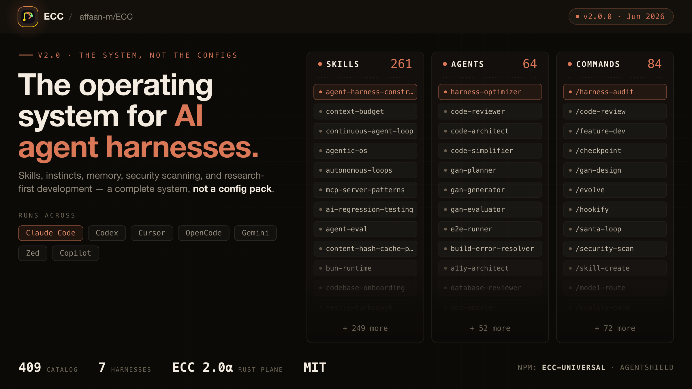
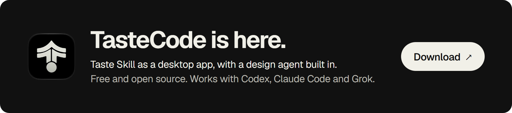
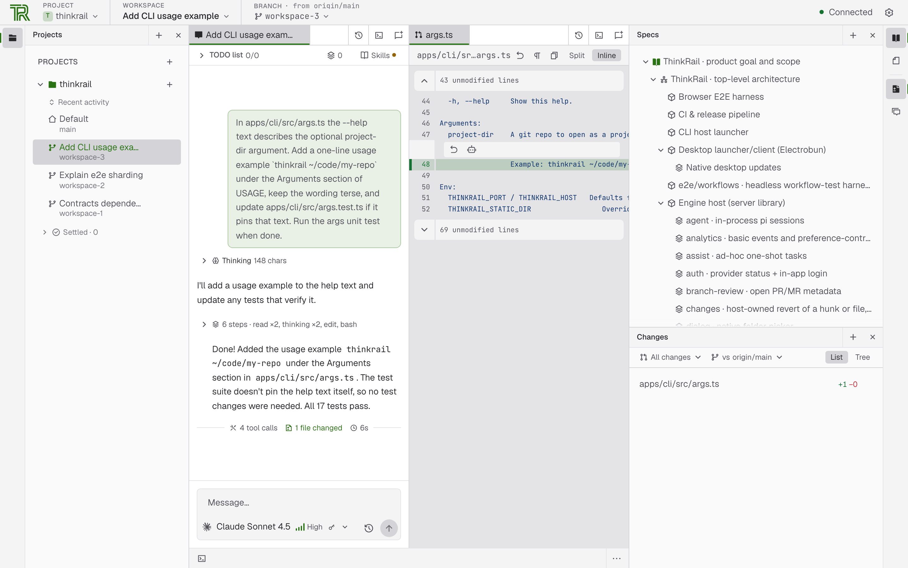

# GitHub 一周热点 · 第 20 期

> 📅 2026-11-02 ｜ 数据来源：GitHub Trending（本周）

> 本期周刊共收录 16 个项目。AI 编码代理方向以可组合的技能框架、工程流程规范与会话记忆系统为主；界面设计类 Skill 聚焦让 Agent 产出的界面遵循统一设计语言并自带检查规则；开发工具方面涉及远程操控编码代理的控制面板与跨平台终端模拟器。

## AI 编码代理工作流与技能框架

### [obra/superpowers](https://github.com/obra/superpowers)

- ⭐ 累计 Star：310,684
- 🔥 本周新增 Star：5,896
- 💻 Shell

一套面向编码智能体的完整软件开发方法论，由可组合技能与初始指令构成，让 Claude Code、Codex、Cursor、Gemini CLI 等十几种 AI 编码工具遵循统一流程：先头脑风暴澄清需求并生成设计文档，再在 git worktree 隔离环境中把计划拆成 2-5 分钟的小任务，由子智能体逐个执行与代码审查，全程强制 TDD（红-绿-重构）、YAGNI 和 DRY。技能会自动触发，出问题时还有 diagnosing-superpowers 技能读取会话记录、给出带证据的诊断。由 Jesse Vincent 与 Prime Radiant 团队维护，MIT 协议，提供企业级商业支持。

**简单说：** 它相当于给 AI 编程助手装上一套工程纪律：不让模型一上来就乱写代码，而是先问清需求、写计划、写测试再写代码、每步都审查。适合已经在用 Claude Code、Cursor 等工具但苦恼于 AI 输出质量不稳定、流程混乱的开发者。

`#ai` `#coding` `#skills` `#sdlc` `#subagent-driven-development` `#brainstorming`

### [affaan-m/ECC](https://github.com/affaan-m/ECC)

- ⭐ 累计 Star：294,870
- 🔥 本周新增 Star：6,299
- 💻 JavaScript
- 🔗 官网：https://ecc.tools

一套面向 AI 编码代理的性能优化系统，核心理念是为智能体提供统一的工程化流程与工具箱：先规划、写测试、实现、从新上下文自审、验证、记忆并沉淀为可复用技能。内置 71 个代理、314 个技能、98 个旧命令，以及 hooks、记忆、持续学习和 AgentShield 安全扫描。目前在 Claude Code 上体验最佳，另提供 Codex、Qoder 原生插件，以及面向 Cursor、OpenCode、Gemini、Zed、Copilot 等十余种工具的 install.sh 适配，支持 minimal/full/core 等多种 profile，可用 consult 命令按需挑选组件或完全手动安装。MIT 协议，通过 npx ecc-universal 向导完成配置，配套付费的 ECC Pro（GitHub App）用于私有仓库。

**简单说：** 它把同一套 AI 编程助手配置（技能、规则、钩子）装进你正在用的各种 AI 编程工具里，就像一个跨平台安装器——用 Claude Code、Cursor 还是 Copilot 都能共享同一套工作流，不想全装也能只挑需要的部分。

`#ai-agents` `#claude-code` `#developer-tools` `#llm` `#mcp` `#productivity`

### [anthropics/skills](https://github.com/anthropics/skills)

- ⭐ 累计 Star：186,405
- 🔥 本周新增 Star：2,600
- 💻 Python

Anthropic 官方的 Agent Skills 示例仓库，展示 Claude 的技能系统：技能是以文件夹形式存在的指令、脚本和资源，Claude 按需动态加载以可重复方式完成特定任务。仓库涵盖创意设计、开发测试、企业沟通、文档处理等多类示例，其中 docx、pdf、pptx、xlsx 是驱动 Claude 文档能力的源码可用实现，其余多为 Apache 2.0 开源。技能结构很简单：一个含 YAML frontmatter（name 与 description）和 Markdown 指令的 SKILL.md 文件，可在 Claude Code、Claude.ai 和 Claude API 中使用。

**简单说：** 它相当于一份教 Claude 干活的标准化菜谱集合，开发者可以照着模板给自己的业务写技能，让 Claude 按固定流程处理文档、数据或自动化任务，省去每次重复写提示词的麻烦。

`#agent-skills` `#claude` `#prompts` `#skills` `#mcp` `#document-processing`

### [multica-ai/andrej-karpathy-skills](https://github.com/multica-ai/andrej-karpathy-skills)

- ⭐ 累计 Star：228,045
- 🔥 本周新增 Star：4,459
- 💻 Unknown

提供一个 CLAUDE.md 文件，把 Andrej Karpathy 对 LLM 编码缺陷的观察总结成四条可执行原则：编码前先思考（显式表达假设、暴露分歧、主动反问）、极简优先（不写多余抽象与投机功能）、外科式修改（只改任务涉及的代码，不做顺手重构）、目标驱动执行（把指令转化为可验证的成功标准并循环验证）。可通过 Claude Code 插件安装，也可直接放入项目 CLAUDE.md，仓库还附带 Cursor 规则文件以复用同一套准则。

**简单说：** 它相当于给 AI 编程助手写的工作守则，减少 AI 乱改代码、过度设计、闷头猜需求的问题。经常用 Claude Code、Cursor 这类工具写代码的开发者，把它加进项目就能让 AI 输出更克制、更可控。

`#claude-code` `#llm` `#prompt-engineering` `#coding-agents` `#guidelines`

### [thedotmack/claude-mem](https://github.com/thedotmack/claude-mem)

- ⭐ 累计 Star：109,456
- 🔥 本周新增 Star：5,852
- 💻 TypeScript
- 🔗 官网：https://claude-mem.ai

为 Claude Code 等 AI 编程代理设计的持久化记忆系统：通过生命周期钩子自动捕获会话中的工具使用记录，用 AI 压缩成语义摘要，存入 SQLite 与 Chroma 向量库，再在新会话开始时注入相关上下文。提供 4 个 MCP 搜索工具（search、timeline、get_observations 等），采用三层渐进式查询流程，先取索引再取详情，可节省约 10 倍 token。一条命令即可接入 Claude Code、OpenCode、Codex、Grok Bot、OpenClaw 等多种代理，并内置 Web 查看器、本地 Worker 服务、TeamBrain 团队共享工作区与多语言模式（含简体中文）。采用 Apache License 2.0，基于 Claude Agent SDK 与 TypeScript 构建。

**简单说：** 它相当于给 AI 编程助手加了一块硬盘：每次会话结束就自动把干过的活记下来、压缩归档，下次开会话再把相关的记忆塞回去，省得每次都要重新解释项目背景。经常用 Claude Code 等工具做长期项目的人会用到。

`#ai-memory` `#claude-code` `#long-term-memory` `#rag` `#ai-agents` `#embeddings`

## 界面设计类 Agent Skill

### [Nutlope/hallmark](https://github.com/Nutlope/hallmark)

- ⭐ 累计 Star：44,987
- 🔥 本周新增 Star：11,566
- 💻 CSS
- 🔗 官网：https://www.usehallmark.com/

由 Together AI 打造、面向 Claude Code、Codex、Cursor 和 OpenCode 的反 AI 味网页设计技能：从 50 个主题素材中发 3 个供选择，围绕用户来访目的搭建页面，并在真实浏览器中用 sloplint 检查典型机器生成痕迹（如每个标题上方的 eyebrow、标题里单个彩色词、页尾千篇一律的邮箱订阅等）。质量门槛分三档：Floor 项永不放行（对比度、焦点、reduced motion、虚构事实、手机端布局破损），Reflex 是模型默认习惯、有理由可记录豁免，Finish 只作工艺细节不阻塞发布。v2 支持 custom 纯提示词设计、指向真实 URL/本地服务自动截图、755 张开放许可照片，以及 /hallmark redesign 与 /hallmark audit 两条命令，分别用于保留内容与接线的重做和仅出报告的审查。

**简单说：** 它是一个给 AI 编程助手用的设计规则包，让 AI 生成的落地页不再一眼看出是模板货——专治那些千篇一律的 AI 味排版，想用 Claude Code 或 Cursor 快速做出像样官网的人会用到。

`#design-skill` `#ai-slop` `#claude-code` `#cursor` `#frontend` `#web-design`

### [pbakaus/impeccable](https://github.com/pbakaus/impeccable)

- ⭐ 累计 Star：99,451
- 🔥 本周新增 Star：12,017
- 💻 Rust
- 🔗 官网：https://impeccable.style

一套给编码 Agent 使用的设计技能包，通过 24 个命令（如 polish、bolder、critique、audit）让 AI 在生成和评审界面时有明确的设计语言可依循。内置 62 条确定性规则的 slop 检测器（无 LLM、无需 API key），可在 Agent 的设计 hook、CI/终端 CLI 或浏览器插件三种方式下运行，用于在交付前拦截 AI 生成的千篇一律的界面。安装后在项目中运行 /impeccable init 生成 PRODUCT.md，后续命令据此上下文工作，支持 Claude Code、Cursor、Codex 等众多编码工具。

**简单说：** 它解决的是 AI 写前端时总长成一个样（紫蓝渐变、Inter 字体、套娃卡片）的问题：给 Agent 一套设计词汇和评审工具，让生成的页面更有设计感，并在交付前自动查出烂设计。

`#agent-skills` `#ai` `#anti-slop` `#design` `#frontend`

### [jakubkrehel/skills](https://github.com/jakubkrehel/skills)

- ⭐ 累计 Star：10,113
- 🔥 本周新增 Star：1,607
- 💻 Markdown
- 🔗 官网：https://jakub.kr/skills

一组面向界面设计的 agent skills 集合，覆盖 UI 打磨、排版、配色、无障碍、布局、产品文案等主题，作者同时经营个人网站与设计工程杂志 Interfaces。skills 分为自动检查类（如 better-interface 输出一份综合报告）、逐项修复类（better-typography、better-colors、better-accessibility、better-layout、better-writing）以及用户主动调用类（interface-review 审查 PR、explain-interface 解释实现、break 压测组件、build-design 还原 Figma、teardown、state-machine、variant）。可通过 npx skills add 安装，也提供 Claude Code 插件市场方式安装。

**简单说：** 它是一套给 AI 编码助手用的设计说明书，装上后 AI 就能像设计工程师一样检查和改进你的界面，适合想让 AI 产出更精致 UI 的开发者。

`#agent-skills` `#ui-design` `#accessibility` `#typography` `#design-engineering`

### [Leonxlnx/taste-skill](https://github.com/Leonxlnx/taste-skill)

- ⭐ 累计 Star：107,887
- 🔥 本周新增 Star：5,336
- 💻 JavaScript
- 🔗 官网：https://tasteskill.dev

面向编码代理的 Agent Skill，让 Claude Code、Codex 等 AI 编程工具在做网页和应用界面时具备设计判断力，而不是拼出千篇一律的 AI 风格落地页。基于对 247 个精选网站的研究构建，流程分六步：读取需求、从 20 个设计方向中随机发牌选定其一、提炼核心创意、使用开放档案中带署名的真实图片搭建、在真实浏览器中以三种宽度检查并淘汰平庸页面、再看自己的截图迭代修复。v2.1 起还覆盖仪表盘和应用界面，附带专属样式与检查规则；整个过程约需 30 到 45 分钟，依赖 Node 22+ 与本地 Chrome/Edge/Chromium，无需额外依赖或 API key。

**简单说：** 它相当于给 AI 编程助手配了一位设计总监，解决 AI 生成的网页都长得一个样的问题——开发者用一句话需求就能让代理做出有真实配图、经过浏览器自查的像样页面。

`#agent-skills` `#ai-agents` `#frontend` `#ui-design` `#web-design` `#claude-code`

## AI 垂直场景应用

### [AgriciDaniel/claude-seo](https://github.com/AgriciDaniel/claude-seo)

- ⭐ 累计 Star：25,588
- 🔥 本周新增 Star：5,034
- 💻 Python
- 🔗 官网：skool.com/ai-marketing-hub-pro

面向 Claude Code 的免费开源 SEO 审计插件，提供 26 个子技能与 19 个专家子代理，最多 17 个代理可并行审计站点，10 到 15 分钟内输出按优先级排序的行动计划。覆盖技术 SEO、E-E-A-T、Schema.org、AI 搜索（GEO/AEO）、代理就绪度、外链、本地 SEO、电商与国际 SEO，并可通过 Google API（GSC、PageSpeed、CrUX、GA4 等）生成 PDF/Excel 报告，审计支持无头浏览器渲染 JS 页面。注意完整 /seo audit 中 5 个子代理跑在 Opus 上，全量审计比单页检查更费额度，各代理模型可在 agents/ 目录自行修改；无 Google API 密钥时 Core Web Vitals 只是实验室估算。另提供 9 个可选扩展（Banana 图片、SE Ranking、Profound、Bing Webmaster、Unlighthouse 等）接入实时数据，不装也能完整使用。

**简单说：** 它相当于把一个 SEO 顾问的完整检查清单搬进 Claude Code，你给它一个网址，它自动派多个 AI 代理并行找问题，最后给你一份按重要性排序的修复清单。适合想省下外包审计费用、又需要覆盖 AI 搜索优化的站长和营销人员。

`#ai` `#ai-seo` `#claude-code` `#claude-code-skill` `#marketing-automation` `#seo`

### [TauricResearch/TradingAgents](https://github.com/TauricResearch/TradingAgents)

- ⭐ 累计 Star：119,575
- 🔥 本周新增 Star：5,432
- 💻 Python
- 🔗 官网：https://arxiv.org/pdf/2412.20138

基于 LangGraph 构建的多智能体 LLM 金融交易研究框架，模拟真实交易公司的分工：基本面、情绪、新闻、技术四类分析师并行产出报告，多头与空头研究员通过结构化辩论评估观点，再由交易员、风险管理团队和投资组合经理逐层给出并审批交易决策。支持 CLI 与 Python 两种使用方式，可对接 OpenAI、Gemini、Claude、DeepSeek、Qwen、GLM、Ollama 等提供商，覆盖 Yahoo Finance 支持的美股、港股、A 股与加密货币。数据源方面美股财报取自 SEC EDGAR 并按申报日期还原历史时点，支持传入实际持仓（PortfolioContext）辅助决策，内置跨运行记忆日志（自动结算已到期决策并生成复盘）、可选检查点断点续跑，以及按股票和日期网格批量回测打分的 backtest 工具。README 明确声明仅用于研究，不构成投资建议。

**简单说：** 它把一家交易公司的研究流程拆成多个 AI 角色开会做决策，让开发者能一条命令或几行代码跑出某只股票的分析报告和模拟交易判断，还会记录历史决策、事后复盘打分，适合做 LLM 多智能体和量化研究实验的人。

`#agent` `#finance` `#llm` `#multiagent` `#trading`

## 开发工具与平台

### [JetBrains/thinkrail](https://github.com/JetBrains/thinkrail)

- ⭐ 累计 Star：6,991
- 🔥 本周新增 Star：5,760
- 💻 TypeScript
- 🔗 官网：https://thinkrail.ai/

JetBrains 孵化的 agentic IDE，围绕 pi 编码代理构建：用 git worktree 隔离工作区让多个 agent 并行干活，用 SPEC.md 组成的活规格图谱沉淀项目知识，并支持复用 Agent Skills。提供真实 IDE 体验（Monaco 编辑器、文件树与 git 变更标记、终端、多会话聊天、⌘K 命令面板），可连接 MCP 服务器、自定义 OpenAI 兼容模型网关，以及 JetBrains AI 或自有 provider 的凭据。三层架构为：in-process 运行 pi 的引擎宿主、类型化协议层、React 19 前端。提供桌面应用与 CLI 两种安装方式，Bug 与功能请求走 GitHub Issues，采用 Apache License 2.0 开源。

**简单说：** 它解决的是 AI 写代码不靠谱、上下文老丢、改坏了主分支的问题：给 agent 一个隔离沙盒并行干活，让需求规格常驻项目里被反复读写，适合想认真用 AI 结对编程、又需要 IDE 级管理能力的开发者。

`#agent` `#agentic-ai` `#ai-coding` `#spec-driven-development` `#vibe-coding` `#pi-agent`

### [pingdotgg/t3code](https://github.com/pingdotgg/t3code)

- ⭐ 累计 Star：38,284
- 🔥 本周新增 Star：6,926
- 💻 TypeScript
- 🔗 官网：https://t3.codes

一个 agent harness 控制面板，通过 iOS/Android 移动端、Web 应用和 Electron 桌面端远程操控你机器上的编码 agent，只要本机装好并登录过对应 CLI 即可接管。兼容 Claude Code、Codex、Cursor、Grok Build、OpenCode、Google Antigravity 和 fx 等订阅服务，安装方式覆盖命令行脚本与各平台包管理器。项目完全开源、可 fork，目前处于早期阶段，主要接受小修复而非大型功能贡献。

**简单说：** 它相当于给本机各种 AI 编程 agent 装了一个统一遥控器，让你能用手机或桌面 App 远程查看和控制它们，适合同时用多个 agent 又想随时随地管着的人。

`#ai-tools` `#agent` `#remote-control` `#desktop-app` `#mobile-app` `#open-source`

### [ghostty-org/ghostty](https://github.com/ghostty-org/ghostty)

- ⭐ 累计 Star：63,193
- 🔥 本周新增 Star：589
- 💻 Zig
- 🔗 官网：https://ghostty.org

跨平台终端模拟器，主打速度快、功能丰富和平台原生体验：macOS 端为 SwiftUI 应用并用 Metal 渲染，Linux 端基于 GTK，同时支持多窗口、标签页与分屏。遵循标准并做了 xterm 兼容性审计，支持 Kitty 图形协议、同步渲染等大量现代控制序列，性能与 Alacritty 同级但功能和原生感更强。此外提供零依赖的 C/Zig 库 libghostty（含已可用的 libghostty-vt），供他人构建或嵌入终端功能，目前项目已稳定并在大量日常环境中使用。

**简单说：** 它就是一个更好用的终端程序：既要跑得快，又要功能多、长得像本系统原生软件；另外开发者可以把它的终端解析能力当库嵌进自己的应用里。

`#terminal` `#terminal-emulator` `#zig` `#gpu-acceleration` `#cross-platform` `#libghostty`

## 安全 / 红队评估

### [cloudflare/security-audit-skill](https://github.com/cloudflare/security-audit-skill)

- ⭐ 累计 Star：56,471
- 🔥 本周新增 Star：10,069
- 💻 JavaScript

Cloudflare 开源的 coding-agent skill，把你的代码 agent 变成分阶段的安全审计器：先做侦察并产出架构与覆盖台账，再按台账分派隔离的 hunter 漏洞狩猎，随后由新 agent 对抗性验证候选漏洞，最后写出 confirmed、needs_validation、rejected 三类机器可读记录并生成报告，全部输出经零依赖校验脚本验证。它是 Cloudflare 漏洞发现 harness 的单仓库起点，覆盖内存安全、LLM、Web 协议、供应链、云部署等十余类攻击面；设计原则包括只有独立验证者能确认漏洞、多次运行可累加提升覆盖。通过 skills CLI 安装，需要 Node.js 环境和可沙箱执行目标代码。

**简单说：** 它相当于给代码 agent 装上一套安全审计工作流，让 agent 自己分头找漏洞、互相交叉验证、再输出结构化报告，适合想用 AI 做代码安全审查的团队。

`#security-audit` `#ai-agents` `#code-security` `#vulnerability` `#skills` `#llm`

### [YuJunZhiXue/dsh-purge](https://github.com/YuJunZhiXue/dsh-purge)

- ⭐ 累计 Star：15,445
- 🔥 本周新增 Star：6,644
- 💻 JavaScript

面向官方 DeepSeek Harness（DSH）的红队安全评估插件，当前 1.1.81 版本对应 DSH 0.2.1-rc.2，可在 dsh web 与桌面 EXE 上安装。插件在会话标题旁提供 dock 按钮，包含 Clean（补丁状态、Apply/Restore/Uninstall、提示词编辑、多套规则集）与 Drill（授权后的资产与本地环境演练）两个页面，用于把宿主层的提示词改写、审批门与沙箱策略同模型本身的拒答区分开评估。开源版强制本地实验室范围（仅允许回环与 RFC1918 地址），不附带技能库与知识库，Fork 需署名原仓库且禁止转卖。安装需通过 codeload tarball 用 dsh plugin add 或 pnpm 手动完成，提供 CLI 与 /purge、/rules、/rewind 等命令，Apply 前会备份原文件为 .dshpurge.bak 以便回滚。

**简单说：** 它是一个装在本地 DeepSeek Harness 上的测试插件，帮安全研究人员看清是模型拒绝还是宿主策略拦截，并可按模型切换提示词做受控评估；本质上是改宿主文件再注入提示词，所以提供一键备份、回滚和卸载，且只作用于自己机器上的官方 Harness。

`#deepseek` `#deepseek-harness` `#dsh-plugin` `#harness-jailbreak` `#llm-jailbreak` `#red-team`
